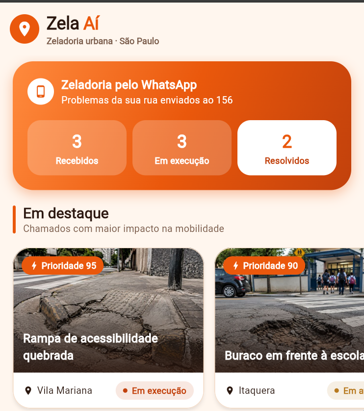
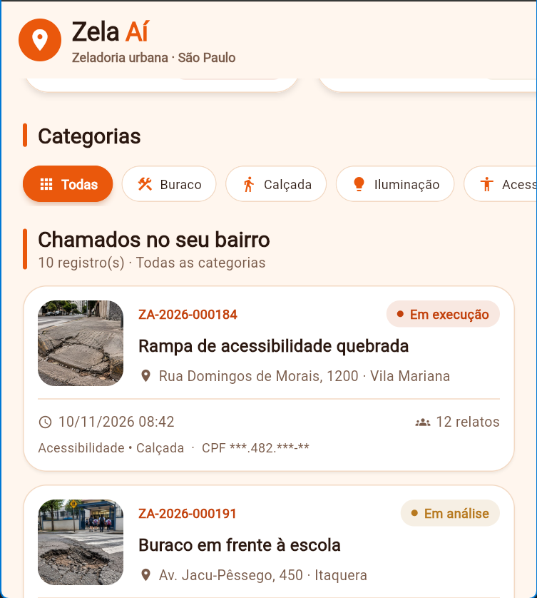
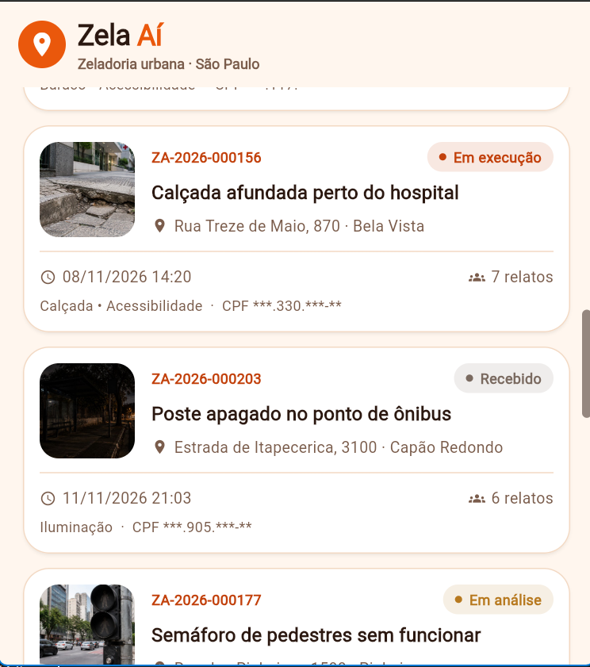

# Zela Aí — App Android (Global Solution 2026)

Aplicativo Android em **Kotlin + Jetpack Compose + Material Design 3** para o tema **CitizenTech** da Global Solution FIAP.

## 👥 Desenvolvedores

| Nome completo | RM |
|---|---|
| Douglas Alexandre Ramos Hamasaki | 560565 |
| Felipe Yuji Mori | 559674 |
| Pedro Henrique Batista Ferrari | 559912 |

Repositório: https://github.com/PHFERRARI7/ZelaAi-Android-Kotlin-Developer.git

## 🌎 Tema da Global Solution

**CitizenTech: zeladoria urbana.** Calçadas, ruas e espaços públicos deteriorados geram transtornos e acidentes, principalmente para pessoas com mobilidade reduzida e idosos.

## 💡 Descrição da solução

O **Zela Aí** é um canal de zeladoria urbana pelo WhatsApp, com IA, integrado ao portal 156 da Prefeitura de São Paulo. O cidadão relata o problema (buraco, calçada quebrada, iluminação apagada...) por texto, áudio ou foto e recebe um protocolo.

Este app é o **painel de acompanhamento**: mostra os chamados abertos, os de maior prioridade e permite filtrar por categoria. Para respeitar a LGPD, o CPF aparece mascarado e não são exibidos nome nem telefone.

## ⚙️ Principais funcionalidades

- **Resumo** com a quantidade de chamados recebidos, em execução e resolvidos.
- **Destaques** (`LazyRow`): chamados com `destaque = true`, exibidos com a foto do problema e o selo de prioridade.
- **Categorias** (`LazyRow`): Buraco, Calçada, Iluminação, Acessibilidade, Lixo e entulho, Sinalização e Árvores, além de **Todas**. A categoria selecionada fica destacada.
- **Lista de chamados** (`LazyColumn`): foto, protocolo, status, título, endereço, data, número de relatos, categorias e CPF mascarado.
- A lista é atualizada automaticamente ao trocar de categoria (`remember` + `mutableStateOf`).
- Mensagem amigável quando a categoria não tem chamados.

## 📱 Fluxo de telas

```
Abrir o app
   └── HomeScreen
         ├── Resumo de status
         ├── Destaques (rolagem horizontal)
         ├── Categorias (toque → filtra a lista)
         └── Lista de chamados (rolagem vertical)
```

## 🖼️ Prints das telas

| Tela inicial (resumo e destaques) | Categorias e lista de chamados | Lista de chamados (rolagem) |
|---|---|---|
|  |  |  |


## 🗄️ Fonte dos dados

**Repositório em memória** (`ChamadoRepository`) com 10 chamados fictícios de bairros de São Paulo. As 10 fotos ficam em `res/drawable` (`foto_*.jpg`, ilustrativas, geradas com IA) e os ícones vêm do pacote `material-icons-extended`. Não há API nem banco de dados; no MVP, a integração com o portal 156 é simulada.


## 🏗️ Arquitetura e organização dos packages

```
br.com.fiap.zelaai
├── MainActivity.kt            # Ponto de entrada: aplica o tema e abre a HomeScreen
├── model/                     # Somente dados (sem dependência de Compose)
│   ├── Chamado.kt             # data class (List<Categoria>, destaque: Boolean, imagem)
│   ├── Categoria.kt           # enum class das categorias
│   └── StatusChamado.kt       # enum class dos status
├── repository/
│   └── ChamadoRepository.kt   # Fonte dos dados e regras de filtragem
├── components/                # Composables reutilizáveis
│   ├── CategoriaVisual.kt     # Ícone de cada Categoria e cor de cada Status (camada de UI)
│   ├── FotoChamado.kt         # Foto do chamado (Image + painterResource)
│   ├── ChamadoCard.kt         # Item da lista principal
│   ├── CategoriaChip.kt       # Chip de categoria + CategoriaList (LazyRow)
│   ├── DestaqueCard.kt        # Card de destaque + DestaqueList (LazyRow)
│   ├── StatusBadge.kt         # Etiqueta de status
│   ├── InfoLinha.kt           # Ícone + texto complementar
│   ├── ResumoCard.kt          # Cabeçalho com resumo
│   └── SecaoTitulo.kt         # Título de seção
├── screens/
│   └── HomeScreen.kt          # Scaffold + TopAppBar + LazyColumn e estado da tela
└── ui/theme/                  # Color, Type e Theme (Material 3)
```

**Separação de responsabilidades:**
- **model** descreve apenas os dados, sem nada de interface.
- **repository** fornece os dados e filtra por `Categoria` (enum, sem strings).
- **components** desenham a UI e recebem dados e eventos por parâmetro.
- **screens** guardam o estado (`categoriaSelecionada`) e ligam o repositório aos componentes.

